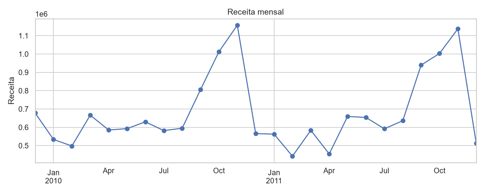
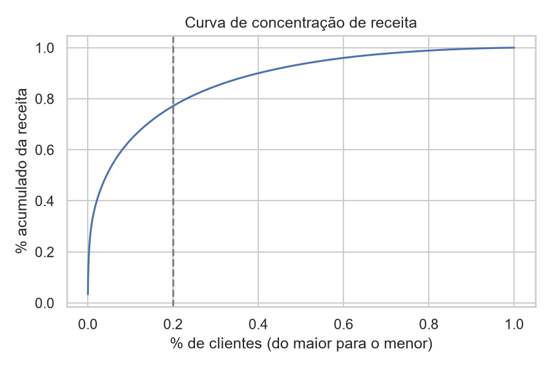
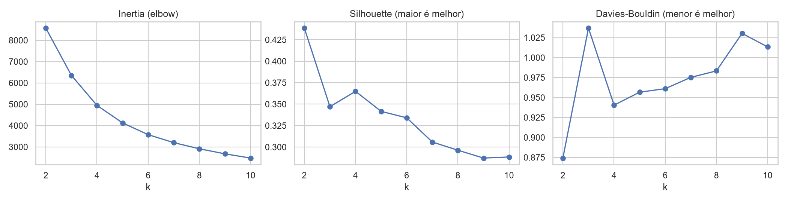
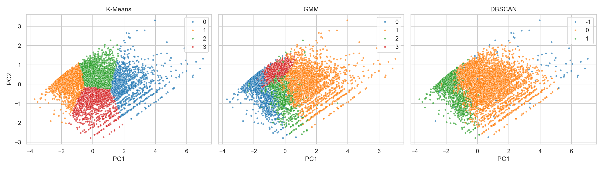
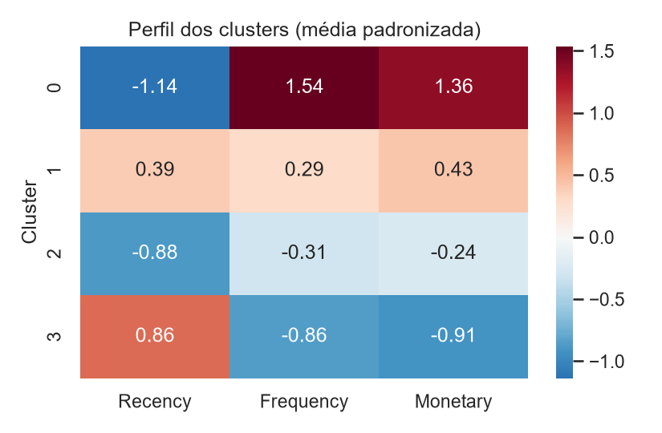
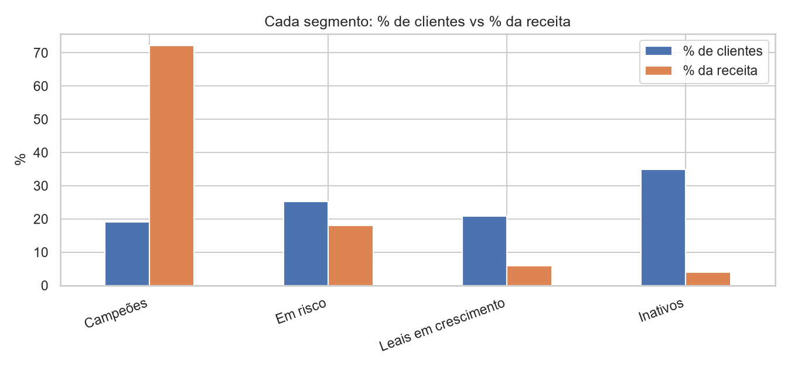
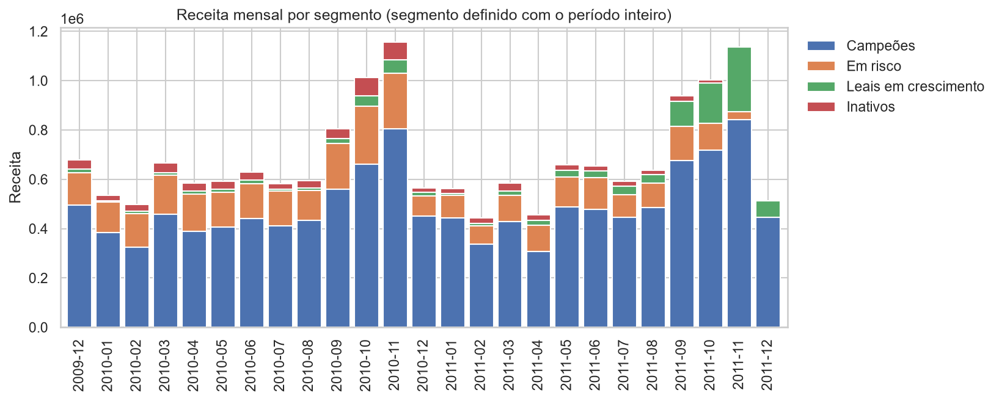
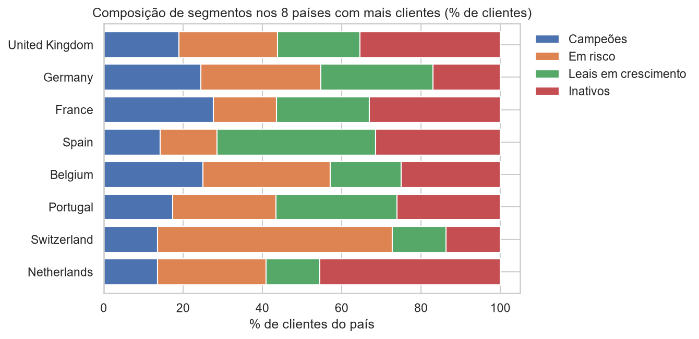

# 🛍️ Segmentação de Clientes com RFM e Clusterização

Projeto de ciência de dados que segmenta os clientes de uma loja online a partir do histórico de compras. Combina **RFM** (Recência, Frequência e Valor Monetário) com **clusterização** (K-Means, MiniBatch K-Means, GMM e DBSCAN) e entrega, para cada grupo, uma **explicação, uma ação de marketing e um indicador de sucesso**, tudo explorável em um **dashboard em Streamlit**.

> **Principais resultados:** 4 segmentos em 5.853 clientes. Os **Campeões** são 19,1% dos clientes e geram **72,1% da receita**; os **Inativos** são 34,9% dos clientes e geram só 4,0%. O grupo **Em risco** (25,2% dos clientes, 18,0% da receita) é o maior alvo para uma campanha de reativação.

## 🎯 Problema de negócio

Tratar todos os clientes da mesma forma desperdiça dinheiro de marketing. As perguntas que o projeto responde:

- Quem são os clientes mais valiosos e quanto da receita eles concentram?
- Quem está esfriando e vale a pena tentar reativar?
- Quem compra pouco, mas pode crescer?
- Como esses grupos se comportam ao longo do tempo e entre países?

## 📊 Dados

[Online Retail II (UCI)](https://archive.ics.uci.edu/dataset/502/online+retail+ii): transações de uma loja online do Reino Unido entre dezembro de 2009 e dezembro de 2011 (1.067.371 linhas, 8 colunas). Os dados não estão no repositório; veja [`data/README.md`](data/README.md) para baixar.

## 🧭 Método

| Etapa | Notebook | O que foi feito |
|---|---|---|
| 1. EDA e limpeza | `01_eda_limpeza` | Junção das duas abas da planilha, remoção de duplicatas, clientes sem ID, cancelamentos, preços e quantidades inválidos e códigos que não são produtos (frete, taxas) |
| 2. Features RFM | `02_rfm` | Recência, Frequência e Valor por cliente, com data de referência fixa; transformação log e padronização; segmentação por regras como baseline |
| 3. Clusterização | `03_clusterizacao` | Escolha do K (elbow, silhouette, Davies-Bouldin), comparação de 4 algoritmos, estabilidade entre sementes (ARI) e visualização com PCA |
| 4. Perfis e negócio | `04_perfis_recomendacoes` | Nome e explicação de cada grupo, ação e indicador, simulação de impacto, visão por tempo e por país |
| 5. Dashboard | `app/app.py` | App em Streamlit com cinco abas |

### Decisões de projeto

- **Data de referência fixa** (10/12/2011, o dia seguinte à última compra da base), para que a recência não dependa da data de hoje.
- **Log + padronização** antes de clusterizar. A assimetria caiu de 0,89 para −0,55 (Recência), de 12,08 para 1,00 (Frequência) e de 25,29 para 0,27 (Valor). A Frequência continua um pouco assimétrica após o log.
- **Baseline por regras** (notas de 1 a 5 em cada dimensão) para verificar se a clusterização acrescenta algo além de regras simples.
- **Comparação justa:** K-Means, MiniBatch K-Means e GMM usam o mesmo K; o DBSCAN escolhe o número de grupos sozinho, e suas métricas são calculadas sem os pontos de ruído.
- **K = 4.** Silhouette e Davies-Bouldin favorecem formalmente K = 2 (0,44 e 0,87), que apenas separaria clientes ativos de inativos. K = 4 é um pico local de silhouette em relação a K = 3 e K = 5 (0,36 contra 0,35 e 0,34), tem Davies-Bouldin de 0,94 (segundo melhor) e produz quatro grupos que o marketing consegue tratar de forma diferente.

## 📈 Resultados

### Limpeza dos dados



| Etapa | Linhas | % do total |
|---|---|---|
| Dados brutos | 1.067.371 | 100,0% |
| Sem duplicatas | 1.033.036 | 96,8% |
| Com CustomerID | 797.885 | 74,8% |
| Sem cancelamentos | 779.495 | 73,0% |
| Quantity e Price > 0 | 779.425 | 73,0% |
| Apenas produtos | 776.840 | 72,8% |

- **23% das linhas não têm `CustomerID`**, e por isso ficam fora de uma análise por cliente.
- Cancelamentos somam 19.494 linhas (1,8%) e há 34.335 linhas duplicadas exatas.
- **Base final:** 5.853 clientes, 36.613 notas fiscais, 4.624 produtos e 41 países, com receita total de 17,1 milhões, de 01/12/2009 a 09/12/2011.
- O **Reino Unido concentra 83,7% da receita**.

### Concentração de receita



Os **20% de clientes que mais compram respondem por 77,2% da receita**. A distribuição é muito concentrada: a mediana de gasto por cliente é 856, mas a média é 2.919, puxada por poucos clientes enormes (o maior gastou 580.987).

### Comparação dos algoritmos



| Algoritmo | Clusters | % ruído | Silhouette | Davies-Bouldin | Calinski-Harabasz |
|---|---|---|---|---|---|
| **K-Means** | 4 | 0 | **0,36** | **0,94** | **4.972** |
| MiniBatch K-Means | 4 | 0 | 0,32 | 1,02 | 4.701 |
| GMM | 4 | 0 | 0,22 | 1,15 | 3.038 |
| DBSCAN (eps 0,5; min_samples 6) | 2 | 1,1 | 0,28* | 1,01* | 2.882* |

\* Calculado sem os pontos de ruído; não é diretamente comparável com os demais.

- **O K-Means foi o melhor nas três métricas** e é o modelo usado no restante do projeto.
- **Estabilidade:** com 10 sementes diferentes, o ARI médio do K-Means é **0,986** (mínimo 0,937), ou seja, o resultado é praticamente o mesmo a cada execução.
- O MiniBatch K-Means, com o mesmo K, chegou a uma divisão bem diferente (ARI 0,51 contra o K-Means) e com métricas piores.
- O GMM foi o pior (silhouette 0,22), e o BIC pediu 10 componentes, sinal de que os dados não seguem uma mistura gaussiana bem definida.
- O DBSCAN só encontra um agrupamento útil em `eps` grande (2 clusters com `eps` 0,5); com `eps` pequeno, ele fragmenta a base em dezenas de clusters e marca muito ruído (21 clusters e 12,9% de ruído com `eps` 0,2).



As duas primeiras componentes do PCA explicam 95,1% da variância, então a visualização em 2D é fiel aos dados.

### Segmentos encontrados



| Segmento | Clientes | % clientes | % receita | Recência mediana (dias) | Frequência mediana (notas) | Gasto mediano | Ação recomendada |
|---|---|---|---|---|---|---|---|
| **Campeões** | 1.115 | 19,1% | 72,1% | 15 | 13 | 5.115 | Programa de fidelidade/VIP, acesso antecipado a lançamentos e pedido de indicações |
| **Em risco** | 1.477 | 25,2% | 18,0% | 158 | 5 | 1.569 | Campanha de reengajamento com lembrete e desconto por tempo limitado |
| **Leais em crescimento** | 1.219 | 20,8% | 5,9% | 23 | 3 | 706 | Venda cruzada e incentivo à próxima compra, como frete grátis acima de um valor |
| **Inativos** | 2.042 | 34,9% | 4,0% | 400 | 1 | 290 | Campanha de baixo custo; testar uma última oferta e depois reduzir o investimento |
| Base inteira | 5.853 | 100% | 100% | 95 | 3 | 856 | — |



- **Campeões:** compraram há pouco (15 dias, mediana), com 13 notas fiscais no período e gasto mediano 6,0 vezes o da base. Perdê-los custa mais do que perder qualquer outro grupo.
- **Em risco:** estão há cerca de 5 meses sem comprar (158 dias), mas já tiveram 5 notas e gasto mediano de 1.569. Acumulam **3,07 milhões** em compras passadas.
- **Leais em crescimento:** compraram há pouco (23 dias), mas com 3 notas e gasto mediano (706) abaixo do da base. Representam 20,8% dos clientes e 5,9% da receita.
- **Inativos:** o maior grupo em número de clientes (34,9%) e o menor em receita (4,0%). Compraram pouco (mediana de 1 nota) e há mais de um ano (400 dias).

**Como a clusterização se compara às regras (baseline):** o ARI entre as duas é 0,434, ou seja, concordam em parte. O K-Means isola um grupo de Campeões menor e mais valioso (19,1% dos clientes e 72,1% da receita, contra 25,0% e 68,9% nas regras): 91,3% do cluster dos Campeões coincide com os Campeões das regras. Já o grupo Em risco mistura clientes que as regras separam entre "Leais" (42,4%) e "Em risco" (40,1%), porque o K-Means também considera o valor gasto, e não só recência e frequência.

### No tempo e por país



- **Sazonalidade:** a receita sobe de setembro a novembro nos dois anos, com o pico em novembro (2010 e 2011). Dezembro de 2011 é parcial (os dados vão até o dia 9).
- **Campeões** respondem pela maior parte da receita em todos os meses.
- **Em risco e Inativos** quase não compram nos últimos meses da base. Isso é esperado pela própria definição (segmento por recência), mas confirma que esses clientes pararam de comprar.
- **Leais em crescimento** disparam em outubro e novembro de 2011 (cerca de 770 clientes ativos em novembro), o que sugere muitos clientes recentes nesse grupo.



- **91% dos clientes (5.334 de 5.853) estão no Reino Unido**, que gera 83,7% da receita. Os outros 40 países têm poucos clientes (Alemanha 106, França 94, Espanha 35, Bélgica 28).
- A composição dos grupos varia entre países: Alemanha (24,5%) e França (27,7%) têm uma fatia maior de Campeões que o Reino Unido (19,0%). Com cerca de 100 clientes por país, isso é um **indício, não uma conclusão**.

### Impacto estimado (simulação)

Se uma campanha reativasse **10% dos 1.477 clientes Em risco** (premissa hipotética), cerca de 148 clientes voltariam a comprar, com receita estimada de **306.932, ou 1,8% da receita total do período**. É um teto de referência, não uma previsão: o valor por cliente acumula os dois anos inteiros, e a taxa de 10% é uma hipótese que, em um caso real, viria de um teste A/B.

## 📊 Dashboard

```bash
streamlit run app/app.py
```

O dashboard lê os arquivos que o notebook 04 grava em `app/data/` (pequenos e versionados no repositório, para o app poder ser publicado). Ele tem cinco abas:

- **Visão geral:** peso de cada segmento em clientes e em receita, e recência × valor
- **Por que os grupos existem:** mapa de calor do perfil de cada grupo, comparação com a base e explicação de cada segmento com a ação recomendada
- **Evolução no tempo:** receita, clientes ativos e notas fiscais por mês e segmento, entrada de clientes e mês da última compra
- **Países:** clientes por país e composição dos segmentos em cada um, com o n de cada país
- **Clientes:** lista filtrável com download em CSV

Filtros na lateral: segmentos, países e faixa de recência.

⚠️ **PREENCHER:** adicione 1 ou 2 prints do dashboard em `reports/figures/` (por exemplo `dashboard_geral.png`) e referencie aqui com ``. Se publicar no Streamlit Community Cloud, coloque o link aqui.

## ⚠️ Limitações

- **Duplicatas das duas abas:** as abas da planilha se sobrepõem por alguns dias em dezembro de 2010. Removi as duplicatas exatas (34.335 linhas), o que também pode eliminar algumas linhas legítimas repetidas dentro de uma mesma nota.
- **23% das transações sem cliente:** ficam fora da análise. Se esses compradores se comportam diferente dos identificados, o resultado não os representa.
- **Segmento retrospectivo:** o segmento de cada cliente é definido com o período inteiro. Os gráficos de tempo mostram como os clientes que **hoje** estão em cada grupo se comportaram no passado; um cliente "inativo" hoje pode ter sido ativo em 2010.
- **Início do período:** o primeiro mês da base também reúne clientes que já existiam antes dele, então a entrada de clientes nesse mês aparece inflada.
- **Separação moderada entre os grupos:** o silhouette do modelo escolhido é 0,36, o que indica grupos reais, mas com fronteiras difusas. Isso é comum em comportamento de compra, que é um contínuo, e por isso as ações devem ser vistas como hipóteses a testar.
- **Descrição, não causa:** os textos de "por que o grupo existe" descrevem padrões de comportamento; não explicam as causas.
- **Simulação hipotética:** a taxa de reativação é uma premissa.
- **Países pequenos:** o Reino Unido concentra 91% dos clientes, então os demais países têm percentuais instáveis. O dashboard mostra o n ao lado de cada país por isso.
- **Dataset de uma empresa só:** os resultados descrevem esta loja; não se generalizam automaticamente para outros negócios.

## 🔭 Próximos passos

- Publicar o dashboard no Streamlit Community Cloud
- Testar as ações de marketing com um experimento A/B real
- Recalcular o RFM em janelas de tempo (por exemplo, trimestral) para acompanhar a migração de clientes entre segmentos
- Incluir variáveis além de RFM (categoria de produto, ticket médio, sazonalidade de compra)

## ▶️ Como rodar

```bash
git clone https://github.com/MatheusBs13/segmentacao-clientes-rfm.git
cd segmentacao-clientes-rfm
python -m venv .venv
source .venv/bin/activate        # Windows: .venv\Scripts\activate
pip install -r requirements.txt
```

1. Baixe os dados conforme [`data/README.md`](data/README.md).
2. Rode os notebooks na ordem, de `01` a `04`, em `notebooks/` (`jupyter lab`).
3. Abra o dashboard: `streamlit run app/app.py`.

## 📁 Estrutura

```
├── data/              # dados (não versionados) e instruções de download
├── notebooks/         # 01_eda_limpeza ... 04_perfis_recomendacoes
├── src/               # funções reutilizáveis (RFM e segmentação por regras)
├── app/               # dashboard Streamlit (app.py) e seus dados (app/data/)
├── reports/figures/   # gráficos usados neste README
└── requirements.txt
```

## ✅ Roadmap

- [x] 01 — EDA e limpeza
- [x] 02 — Features RFM
- [x] 03 — Clusterização e comparação de algoritmos
- [x] 04 — Perfis, explicações, tempo e países
- [x] 05 — Dashboard em Streamlit

## 🛠️ Tecnologias

Python, pandas, NumPy, scikit-learn, matplotlib, seaborn, Plotly e Streamlit.

## 👤 Autor

[MatheusBs13](https://github.com/MatheusBs13)
